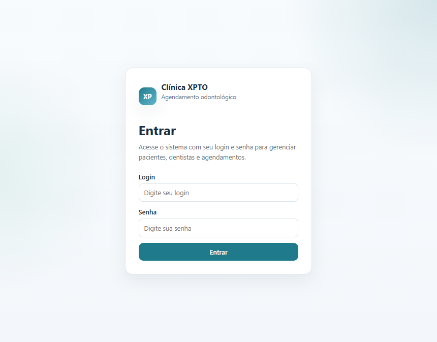
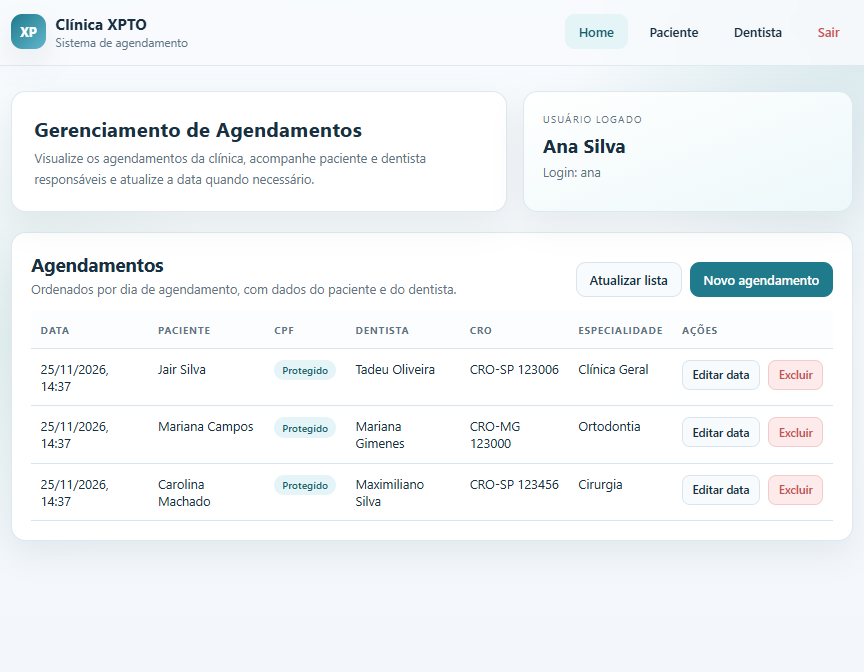
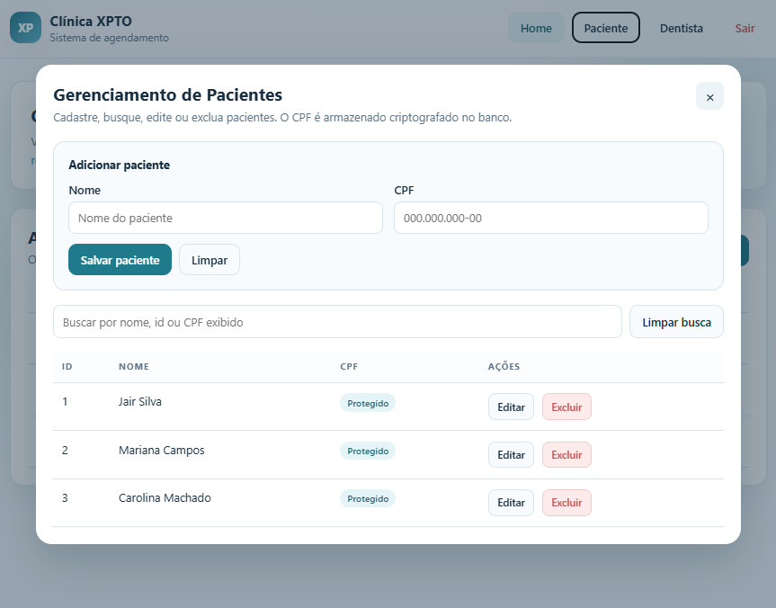
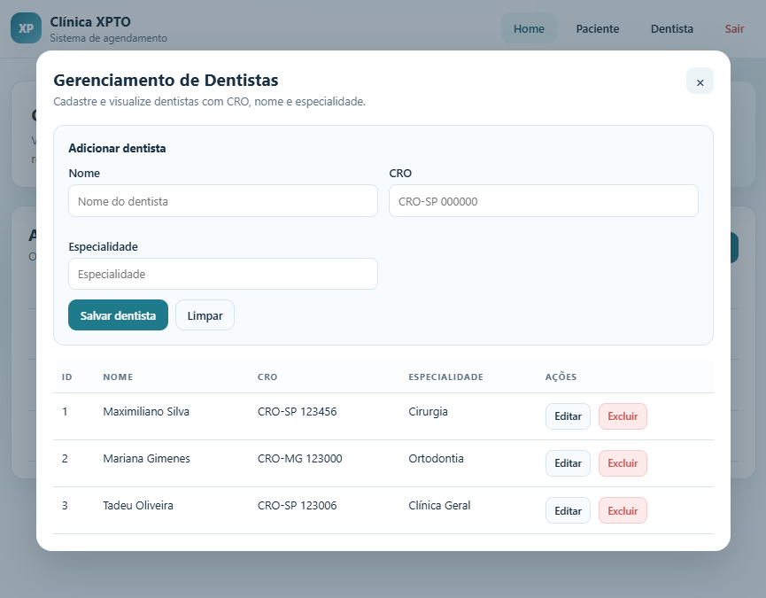

# Dentistas XPTO (Agendamentos)
Sistema Web Full-stack de agendamentos em uma clínica dentária
## [Situação desafiadora](./situacao_desafiadora.md)

## [Documentação](./documentacao.md)

### Tecnologias
- VsCode
- Node.js
- JWT
- HTML, CSS, JS
- XAMPP - MySQL(MariaDB)

### Passos para executar e testar localmente
- Clonar este repositório e abrir com o **VsCode**
#### API
- Criar o arquivo `api/.env` contendo:
```js
PORT=3000
DATABASE_URL="mysql://root@localhost:3306/clinicaxpto"
JWT_SECRET="meu_codigo_secreto"
```
- Abrir o **terminal** `CTRL +'` do VsCode, navegar até a pasta API e instalar as dependências:
```bash
cd api
npm install
```
- Abrir o XAMPP dar **Start** no **MySQL** e implantar o banco de dados e os dados de teste
```bash
npx prisma generate
npx prisma migrate dev --name init
npx prisma db seed
```
- Executar o servidor
```bash
npm run dev
```
#### UI(User Interface) Web, Front-end
- Executar o arquivo `web/index.html` com a extensão **Live Server** do **VsCode**
- Fazer login com as credenciais:
```txt
login: ana
senha: senha123
```

<details><summary><h3>Screenshots da Interface</h3></summary>






</details>
"# senai_dentista_fullstack_2026" 
