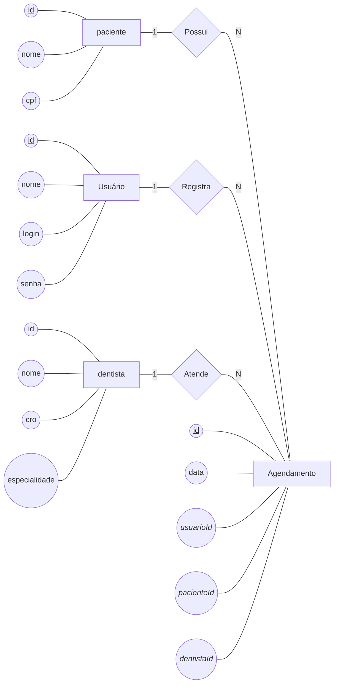

# Documentação
Documentação básica do sistema de agendamento de consultas para a Clínica dentária XPTO
## Requisitos funcionais do Sistemas

|ID|Requisito|Descrição|
|-|-|-|
|[RF001]|Login|Login com autenticação JWT com tokem expirando em 30 minutos|
|[RF001.1]|Login|Campos **login** e **senha** (senha criptografada com pacote bcrypt do Node.js)|
|[RF002]|Tela Principal|Tepa principal acessada somente se o login obtiver sucesso Exibindo o nome do usuário, um menu com as opções [Home, paciente, dentista e Sair] e fazendo o gerenciamento de Agendamentos no corpo desta página|
|[RF003]|Gerenciamento de pacientes|Modal exibindo a lista de pacientes editável e permitindo excluir, campo de busca/filtro, formulário para adicionar novo paciente e CPF criptografado no banco de dados|
|[RF004]|Gerenciamento de dentistas|Modal exibindo a lista de dentistas, formulário para adicionar novo dentista relacionado a um paciente|
|[RF005]|Agendamento|Na tela principal deve conter a listagem dos agendamentos cadastrados ordenado por dia de agendamento, trazendo todos os dados do paciente e do dentista, permitindo atualizar a data do agendamento|

## Requisitos de infraestrutura 
- SGBD Utilizado: MySQL (MariaDB) 
    - Versão: 10.11.16-MariaDB MariaDB Server 
- Linguagem de Programação: Node.js JavaScript 
    - Versão: v26.13.1

## MER DER Conceitual

## MER DER Conceitual - versão Draw.io
